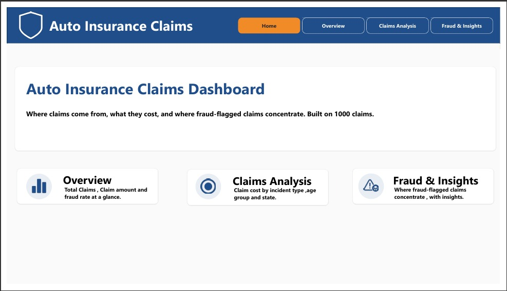
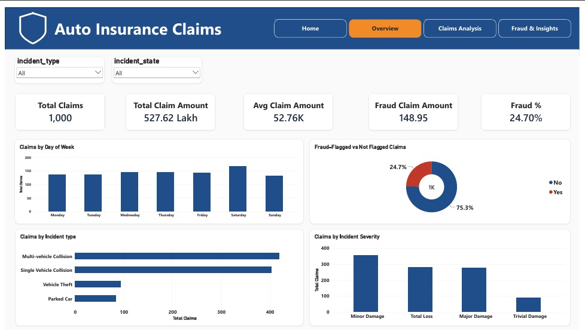
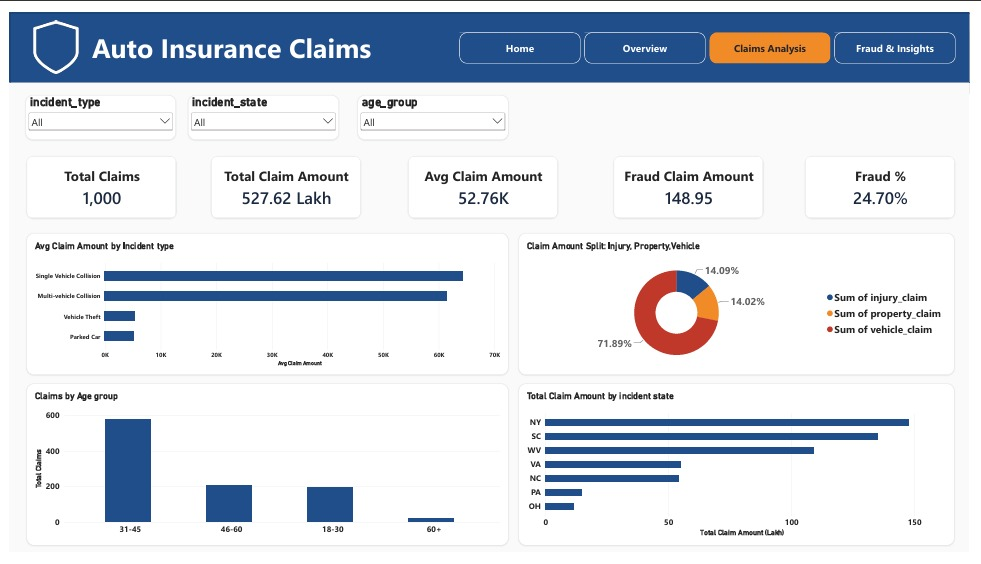
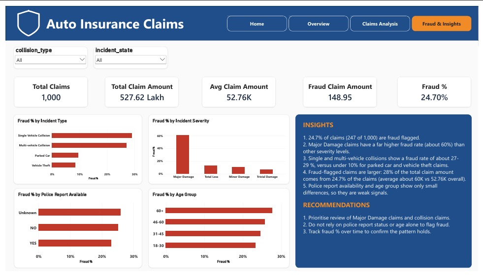

# Auto Insurance Claims Analysis Dashboard

## Business Problem
An insurer needs to know where claims come from, what they cost and where fraud-flagged claims concentrate. This project cleans the claims data in Python and presents the answers in a 4-page Power BI dashboard.

## Dataset
- **Source:** Auto Insurance Claims dataset (Kaggle)
- **Size:** 1,000 claims, 40 raw columns
- **Key columns:** total_claim_amount, incident_type, incident_severity, incident_state, age, collision_type, police_report_available, fraud_reported

## Tools Used
- **Python:** pandas, numpy (data cleaning)
- **Power BI:** dashboard , slicers and page navigation
- Jupyter Notebook in VS Code

## Data Cleaning (Python)
- Checked duplicates: none found.
- Dropped `_c39`, a column that was completely empty.
- Missing values were hidden as "?" in `collision_type`, `property_damage` and `police_report_available`. In `collision_type` they appear only for Parked Car and Vehicle Theft (178 claims), so they were labelled "No Collision". The other two were labelled "Unknown".
- Converted `policy_bind_date` and `incident_date` to dates.
- Created `age_group`, `incident_day` and `fraud_flag`.
- Verified that injury + property + vehicle claim equals total claim for every row.
- Saved the result as `insurance_claims_clean.csv`.

## Dashboard (Power BI)

### 1. Home

Title, purpose and page navigation.

### 2. Overview

KPI cards, fraud split, claims by incident type, severity and day of week.

### 3. Claims Analysis

Average claim by incident type, claim amount split, claims by age group, total amount by state.

### 4. Fraud & Insights

Fraud % by incident type, severity, police report and age group, plus insights and recommendations.

## Key Insights
1. 1,000 claims worth 527.62 lakh in total, an average of about 52.76K per claim.
2. **24.7% of claims (247) are fraud flagged**, worth 148.95 lakh.
3. Multi-vehicle (419) and single-vehicle (403) collisions make up most claims; vehicle theft (94) and parked car (84) are far fewer.
4. Vehicle damage is 71.9% of claim cost, injury 14.1% and property 14.0%.
5. Major Damage claims show a far higher fraud rate (about 60%) than other severity levels.
6. Collisions show a fraud rate of about 27-29%, versus under 10% for parked car and vehicle theft.
7. Fraud-flagged claims are larger: 28% of total claim amount comes from 24.7% of claims.

## Recommendations
1. Prioritise review of Major Damage and collision claims.
2. Do not rely on police report status or age alone to flag fraud.
3. Track fraud % over time to confirm the pattern holds.

## Author
Vandana Lodhiyal
